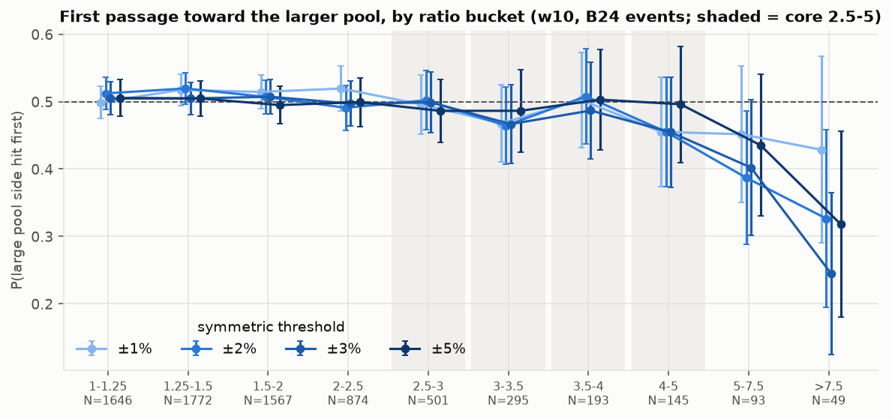
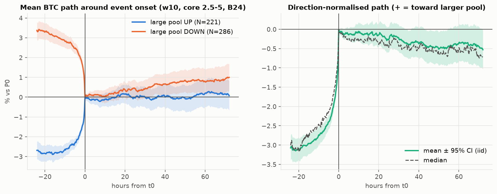

# Does liquidation-map imbalance predict BTC direction?

A reproducible event study of BTC perpetual futures, 2020-12 to 2026-10.

**Short answer: no.** When the estimated liquidation pool on one side of the price is 2.5 to 5 times
larger than on the other, price reaches the larger pool first **52.0%** of the time
(±2% first passage, N = 507, 95% CI 47.8%–56.1%). The imbalance carries information about
**volatility**, which is mostly persistence of volatility that is already present. It carries no
usable information about **direction**. The same holds on a liquidation map calibrated against
real liquidation records (51.9%, CI 48.6%–55.2%).

<p align="center">
  <br>
  
</p>

The second figure shows where the imbalance comes from. In 92.5% of events, price had already moved
about 3% toward the larger pool in the previous 24 hours. A lopsided map is mostly the footprint of
that move.

---

## The question

Traders often read liquidation heatmaps as "price goes to hunt liquidity". This study treats that
as a hypothesis, and tests the opposite hypothesis (price moves away from the larger pool) as well.

| Term | Definition |
|---|---|
| Symmetric window | Liquidation intensity is summed over `[P0·(1−w), P0)` below and `(P0, P0·(1+w)]` above, for w = 3, 5, 7.5, 10, 12.5, 15% |
| Imbalance ratio | `max(L_down, L_up) / min(L_down, L_up)` ≥ 1 |
| Signed log imbalance | `log(L_up / L_down)`: > 0 means the short-liquidation pool above is larger |
| DAR | direction-adjusted return = return × direction of the larger pool; > 0 means price moved toward it |
| First passage | which of `P0·(1±x)` price touches first, from 1-minute highs and lows |

## Main results

| Claim | Verdict | Key evidence |
|---|---|---|
| 2.5–5x imbalance predicts a move toward the **larger** pool | **Not supported** | P = 52.0% [47.8, 56.1]; every core bucket in the ±3–10% windows lies in 45.5–54.5%; calibrated map: 51.9% |
| …toward the **smaller** pool | **Not supported** | no core bucket in the ±3–10% windows is significantly below 50%; low values in the ±12.5/15% windows (N = 20–90 per cell) appear on map M1 only and vanish on M2 and M3 |
| Close-to-close drift toward the smaller pool after events | Weak evidence | −0.29% at 24h (p = 0.13); disappears once matched on the prior 24h move (p = 0.22) and on the calibrated map (p = 0.70) |
| Imbalance has direction information beyond trend, volatility, funding and OI | **Not supported** | incremental R² ≤ 0.06%; walk-forward AUC 0.48–0.51 |
| Higher ratios (3:1, 4:1, 5:1+) predict better | **Not supported** | no monotonic improvement; an apparent tilt at >5x exists on one map only |
| Imbalance predicts larger future volatility / range | Supported (raw), weak (incremental) | 24h range rises from 3.8% to 7.9% across buckets; beyond past volatility only 0.04–0.85% incremental R² |
| Price "seeks" liquidation clusters beyond what distance explains | **Not supported** | the larger cluster is simply closer (median 3.3% vs 8.3% away); at equal distance P ≈ 50%; a random-time placebo shows the same "excess" |
| A simple tradable effect exists, in or out of sample | **Not supported** | trading toward the larger pool loses money; trading against it is +0.15% per trade (p = 0.44) |

Full report (Chinese, conclusions first): [`reports/final_report.md`](reports/final_report.md).
Map validation: [`reports/MAP_VALIDATION.md`](reports/MAP_VALIDATION.md).
Data audit: [`DATA_AUDIT.md`](DATA_AUDIT.md).

## Methodology

- **No look-ahead.** A map snapshot at `t_snap` uses data up to `t_snap` only. The signal becomes
  usable at `t0 = t_snap + 5 min`, and every outcome starts at `t0`. An automated check
  (`src/panel.py::check_no_lookahead`) spot-checks 2,000 random rows: the snapshot price, a trailing
  return recomputed from past bars, and the 5-minute lag.
  Regime labels use expanding-window percentiles; size percentiles use the trailing 365 days.
- **No pseudo-replication.** An imbalance persists, so consecutive 5-minute bars are not independent
  events. Three event definitions are used (threshold crossing with hysteresis, cooldowns of
  6/12/24/48h, episodes), and they agree. Uncertainty comes from a **calendar-month cluster
  bootstrap**, because events in the same month share a market regime.
- **No cherry-picking.** All 700 combinations of window × ratio bucket × threshold (and 600 for
  returns) are reported in `results/tables/results_matrix_*.csv`, with Benjamini–Hochberg FDR
  q-values. A significant cell is flagged "likely unstable / data-mined" when neither the adjacent
  window nor the adjacent bucket supports it.
- **Controls, not stories.** A random-time placebo tests the liquidation-cluster result. A matched
  control (same prior 24h return, no imbalance) tests the post-event drift. Out-of-sample: first
  70% of time in sample, last 30% held out, plus walk-forward regressions with HAC standard errors.
- **The map itself is validated.** The reconstructed map is checked against 62 days of real
  Binance liquidation orders (77,752 orders). The pass criteria were fixed before looking at the
  results, and the outcome is reported even though one of them was missed.

## Data

Everything is public and free; no API key is needed.

| Data | Source |
|---|---|
| BTCUSDT perpetual 1m klines, 5m open interest and long/short ratios, funding, premium index | [Binance public data](https://data.binance.vision) (`futures/um`) |
| Real liquidation orders, first day of each month since 2021-09 | [Tardis.dev](https://docs.tardis.dev) free CSV datasets |

**No historical liquidation map is publicly available.** The map in this study is reconstructed
from 5-minute open-interest changes: new open interest is spread across assumed leverage tiers,
open interest decreases are closed pro rata, and levels are removed when price trades through them.
Three variants are studied: M1 (main), M2 (long/short tilt + 72h decay), and M3 (calibrated on
real liquidations).

Raw data are **not** included in this repository; `main.py` downloads them (about 190 MB of zips,
several GB after processing). Use of the data is subject to the providers' terms.

## Reproduce

Python 3.12.

```bash
pip install -r requirements.txt
python main.py                                    # download -> clean -> map -> outcomes -> audit -> analysis -> figures (~1 hour)
python main.py --stages validate                  # validate / calibrate the map on real liquidations
python main.py --stages none --variant-suite M3   # re-run the core study on the calibrated map
python main.py --match --down 4.0e9 --up 1.3e9 --window 0.10   # historical analogues for a snapshot
```

`--match` takes a current snapshot (liquidation USD below / above, window; optionally `--oi`,
`--rv7d`, `--ret24h`, `--ret7d`). It returns the 20 / 50 / 100 most similar non-overlapping
historical snapshots and their forward return and first-passage distributions. It returns
distributions only, never a point forecast.

Memory: the pipeline was run on a 16 GB machine. It needs several GB free, so close other heavy
applications first. All parameters are in `config/config.yaml`; the random seed is fixed.

## Layout

```
config/config.yaml          every parameter of every specification
main.py                     pipeline entry point (stages)
src/data_loader.py          download + parse (schema mapping)
src/cleaning.py             duplicates, gaps, invalid OI (causal rules), 5m bars
src/liquidation_features.py liquidation-map reconstruction (numba) + imbalance features
src/regimes.py              trend / volatility / funding / OI regimes
src/price_outcomes.py       forward returns, excursions, 1m first passage, cascade proxies
src/panel.py                analysis panel + look-ahead checks
src/event_detection.py      crossing / cooldown / episode events
src/events_table.py         event rows, direction-adjusted outcomes, benchmarks
src/statistics.py           iid + month-cluster bootstrap, binomial, Wilcoxon, FDR, stability flags
src/analysis.py             core / asymmetric tables, results matrix, robustness, clusters, OOS
src/regressions.py          HAC OLS / logit, panel and event level, walk-forward
src/backtest.py             strategy test with fees and slippage
src/matching.py             nearest-neighbour matching
src/liq_validation.py       real-liquidation loader, fast sweep engine, validation metrics
src/validation_run.py       validation + calibration grid (pre-registered metrics)
src/validation_amounts.py   exploratory amount and long/short-split metrics
src/visualization.py        figures
src/data_audit.py           writes DATA_AUDIT.md
results/tables/             every table behind every number in the reports
results/figures/            figures
reports/                    final report, map validation
notebooks/                  exploratory notebook (reads saved results only)
```

## Limitations

- The liquidation map is a model of one exchange (Binance BTCUSDT), not an observation. It matches
  the timing and price levels of real liquidations, but its pre-registered primary validation
  metric scored 0.490 against a 0.5 bar, and the leverage mix is not identified. Results may
  differ for multi-exchange commercial heatmaps.
- Binance's public liquidation feed is throttled, so the real liquidations used for validation are
  a lower bound. They are available for 62 sample days only.
- Single asset. About 500 independent core events, so effects smaller than roughly 5 percentage
  points cannot be ruled out.
- Some robustness analyses (the cluster bootstrap, the matched control, two validation metrics)
  were added after first results were seen; the reports label them.
- The volatility result is benchmarked against past realised volatility only, not against
  HAR-RV or GARCH.

## Disclaimer

Research code. Not investment advice.

## License

[MIT](LICENSE)
